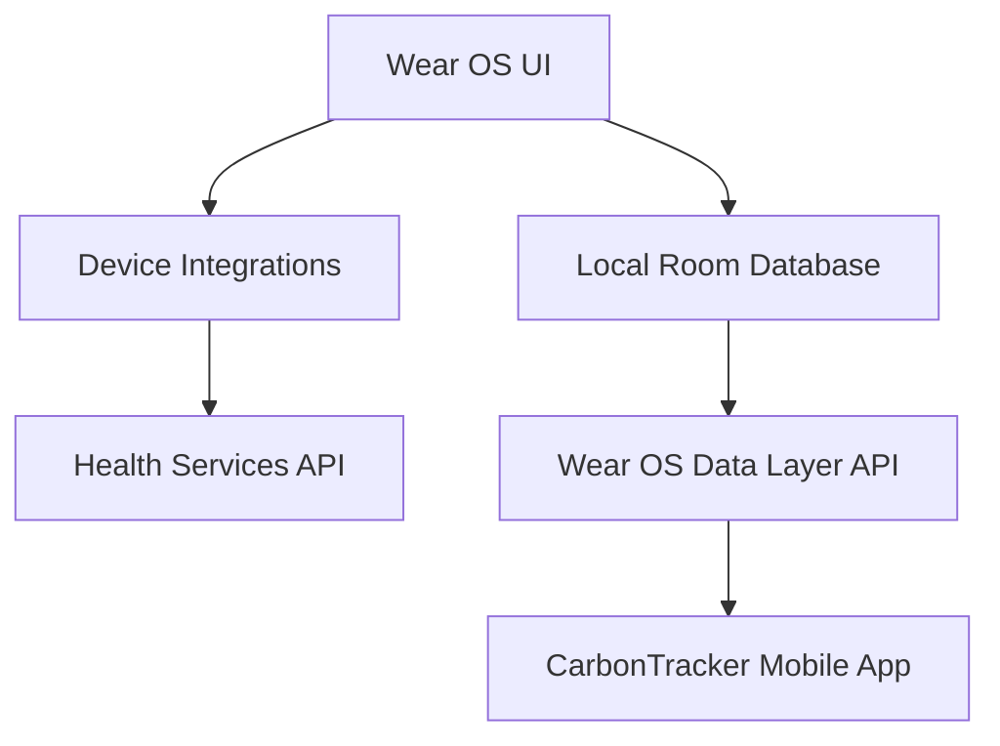
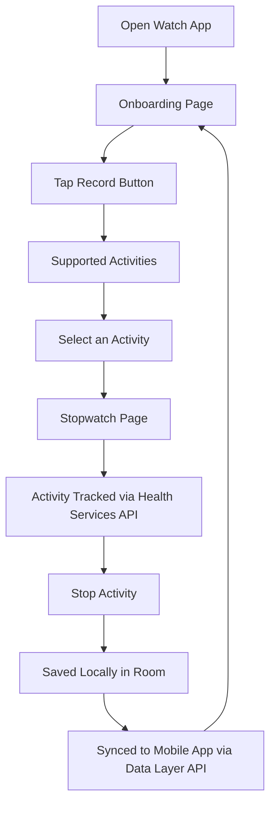
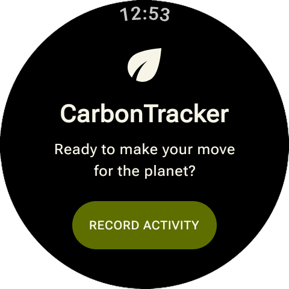
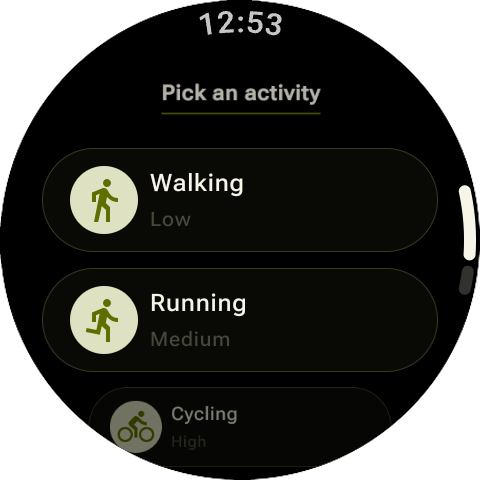
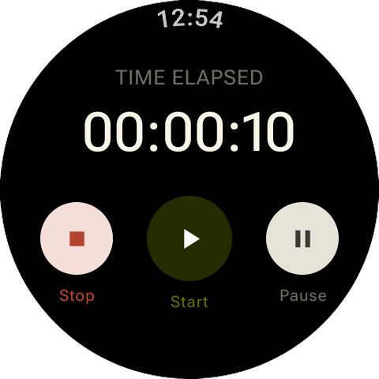

<!-- Don't delete it -->
<div name="readme-top"></div>

<!-- Organization Logo -->
<div align="center" style="display: flex; align-items: center; justify-content: center; gap: 16px;">
  
  
</div>

&nbsp;

<!-- Organization Name -->
<div align="center">

<!-- [](https://TODO.aossie.org/) -->

<!-- Correct deployed url to be added -->

</div>

<!-- Organization/Project Social Handles -->
<p align="center">
<!-- Telegram -->
<a href="https://t.me/StabilityNexus">
</a>
&nbsp;&nbsp;
<!-- X (formerly Twitter) -->
<a href="https://x.com/aossie_org">
</a>
&nbsp;&nbsp;
<!-- Discord -->
<a href="https://discord.gg/hjUhu33uAn">
</a>
&nbsp;&nbsp;
<!-- Medium -->
<a href="https://news.stability.nexus/">
  </a>
&nbsp;&nbsp;
<!-- LinkedIn -->
<a href="https://www.linkedin.com/company/aossie/">
  </a>
&nbsp;&nbsp;
<!-- Youtube -->
<a href="https://www.youtube.com/@AOSSIE-Org">
  </a>
</p>

---

<div align="center">
<h1>CarbonTracker Wear OS</h1>
</div>

CarbonTracker Wear OS is the smartwatch companion of the CarbonTracker mobile application. It lets users record fitness activities directly from their wrist and syncs them with the mobile app.

The app follows a local-first and privacy-focused approach. Activity data is stored on the watch and is never sent to any of our servers.

## Features

- Record fitness activities from your watch
- Choose from a list of supported activities
- Track activity time with a built-in stopwatch
- Activity tracking powered by the Health Services API
- Automatic sync with the CarbonTracker mobile app via the Wear OS Data Layer API
- Local storage on the watch using Room so no data is lost
- No data stored on external servers

## 💻 Tech Stack

### Frontend

- Kotlin
- Room
- Health Services API
- Wear OS Data Layer API

## ✅ Project Checklist

- [ ] **The mobile app** (if applicable):
    - [ ] has an _About_ page containing the Aossie's logo and pointing to the social media accounts of the Aossie.
    - [ ] is available for download as a release in this repo.
    - [ ] is available in the relevant app stores.

## 🔗 Repository Links

1. [Main Repository](https://github.com/AOSSIE-Org/CarbonTracker-WatchCompanionApp)

## 🏗️ Architecture Diagram



## 🔄 User Flow



### Key User Journeys

1. **Starting an Activity**
    - User opens the app and lands on the onboarding page
    - Taps the record button
    - Picks one of the supported activities
    - Lands on the stopwatch page and the activity begins

2. **Tracking an Activity**
    - Stopwatch runs while the activity is tracked using the Health Services API
    - User stops the activity when finished

3. **Syncing with the Mobile App**
    - Activities are saved locally on the watch in Room database.
    - Activities are synced to the CarbonTracker mobile app via the Wear OS Data Layer API
    - No data is stored on our servers

## 🍀 Getting Started

### Prerequisites

Before setting up CarbonTracker Wear OS, make sure you have the following installed:

- Android Studio
- Android SDK (installed via Android Studio)
- JDK (bundled with Android Studio)
- A Wear OS emulator or a physical Wear OS device

Kotlin is included with Android Studio, so no separate installation is needed.

### Installation

#### 1. Clone the Repository

```bash
git clone https://github.com/AOSSIE-Org/CarbonTracker-WatchCompanionApp.git
cd CarbonTracker-WatchCompanionApp
```

#### 2. Open the Project

Open the wear folder in Android Studio (File > Open) and let Gradle finish syncing.

#### 3. Build the App

From the `wear` folder, build the debug APK:

```bash
cd wear
./gradlew assembleDebug
```

#### 4. Run the App

First, check that your Wear OS device or emulator is detected:

```bash
adb devices
```

Then either select your Wear OS device or emulator in Android Studio and click Run, or install from the command line:

```bash
./gradlew installDebug
```

### Testing

The project doesn't have automated tests yet.

Until tests are added, verify changes manually on a Wear OS emulator or physical device:

1. Start an activity from the onboarding page and confirm the stopwatch runs.
2. Stop the activity and confirm it is saved locally.
3. With the CarbonTracker mobile app paired, confirm the activity syncs.

Sensor data from Health Services is most reliable on a physical watch, so use one when testing activity tracking.

To check code quality before opening a PR, run:

```bash
./gradlew lint
```

## 📱 App Screenshots

|                                                              |                                                              |                                                            |
|--------------------------------------------------------------|--------------------------------------------------------------|------------------------------------------------------------|
|  |  |  |

---

## 🙌 Contributing

⭐ Don't forget to star this repository if you find it useful! ⭐

Thank you for considering contributing to this project! Contributions are highly appreciated and welcomed. To ensure smooth collaboration, please refer to our [Contribution Guidelines](./CONTRIBUTING.md).

## ✨ Maintainers

- [Aneesa Fatima](https://github.com/aneesafatima)

## 📍 License

This project is licensed under the GNU General Public License v3.0.
See the [LICENSE](LICENSE) file for details.

---

## 💪 Thanks To All Contributors

Thanks a lot for spending your time helping CarbonTracker grow. Keep rocking 🥂

[](https://github.com/AOSSIE-Org/TODO/graphs/contributors)

© 2026 AOSSIE
